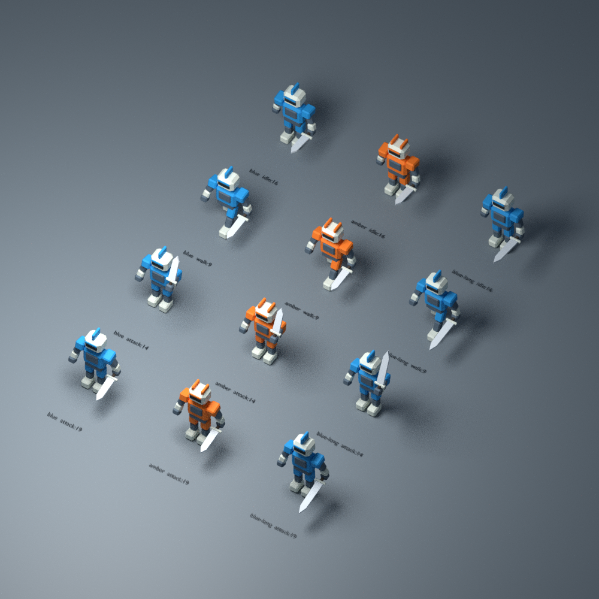

# Beacon Guard：原创战斗占位角色

这是可继续改造的低多边形占位原型，适合先检验俯视角色加载、阵营识别与动作播放接口。全部网格、材质和动作由本目录脚本生成，无第三方素材；产物按 [CC0](LICENSE.txt) 提供。没有接入 MOBA 游戏，也不作为最终美术、手感或无障碍认证。



## 在另一台云电脑重现

工具只需 **Blender 4.3.2（含内置 glTF、Cycles CPU）和 POSIX shell**，无需 GPU、联网或安装 Python/npm 依赖。从仓库根执行：

```sh
sh asset-pipeline/placeholder/run.sh
```

依次重生成三套 Blend/GLB、验证结构与动作、跑真实文件负例，再用 Blender CPU 渲染预览。程序退出非零即失败；生成开始会清除旧验收／预览清单，失败时可能保留部分文件，不能拿旧文件当本次成功。`validation.json` 和 `previews/manifest.json` 记录产物哈希；源脚本与配方才是可维护输入，Blend/GLB 是可重生成产物，Blend 也可打开继续编辑。Blend 序列化哈希不要求跨次相同。

只重新验证已有资产：

```sh
blender -b --factory-startup --disable-autoexec --python-exit-code 1 --python asset-pipeline/placeholder/validate.py
```

## 可编辑合同

- `recipe.json`：阵营颜色、头顶标记类型、初版刀刃长度 `0.75` 米及二改长度 `1.05` 米。身体比例、骨骼连接和动作关键帧在 `build.py`；当前允许刃长 0.2–1.5 米，其他比例未做范围保证。
- `assets/blue.*`：蓝色、单枚高鳍；`amber.*`：橙色、双枚短鳍。标记是独立几何，俯视图可数出一枚／两枚；没有把只换颜色当成无障碍完成。
- `assets/blue-long.*`：刀刃加长 0.30 米。只允许 `WeaponBlade` 顶点改变，握柄、护手、其他网格／材质、15 根骨骼及三段动作数据保持。握柄／护手／刀刃均蒙皮到 `Hand_R`，不会成为脱手的静态装饰。
- 朝向：Blender Z 向上、角色面向 -Y，单位米；GLB 使用 glTF Y 向上。15 骨骼、6 个材质，无贴图或外部 URI。蓝版及长刃版各 1076 三角形，橙版 1120；GLB 因硬边拆点，分别 2340／2436 顶点。三套 Blend+GLB 合计约 0.96 MB。
- 动作均为 30 fps：`idle` 1–31 帧、`walk` 1–33 帧，首末姿态闭合；`attack` 1–36 帧，14 帧蓄势、19 帧挥下。导入 Blender 的 GLB 动作名增加 `_GuardRig` 后缀，GLB 内原动作名仍为 `idle`、`walk`、`attack`。Walk 是原地走，Root 只做脚底贴地的竖直校正；播放速度、移速匹配和攻击命中时刻应由未来消费者另定。

## 实际检查与可见限制

`validate.py` 用 Blender 分别打开三套 Blend 和 GLB，每四帧及末帧采样实际变形点；源→GLB 点差阈值 0.2 毫米，实测最大约 0.0032 毫米。比对双色版未改结构，以及长刃二改前后的顶点、拓扑、蒙皮、骨骼静止矩阵、动作曲线、材质和未改网格采样。另用真实篡改的躯干文件、缺失文件和删掉 walk 的文件确认拒绝路径。

已实际查看两张 Blender 预览：三列为蓝／橙／蓝长刃，四行为 idle:16、walk:9、attack:14、attack:19。斜俯视下头、身体、手持物分离，蓄势与挥下能区分；顶视下单鳍／双鳍及长短刃可见。提高刀刃亮度并压暗背景后，静止刀刃轮廓比初版清楚。原步行鞋尖入地已通过脚踝补偿和逐帧脚底校正修正；验证采样的最低高度为 0，预览未见明显鞋尖穿地、刀穿躯干或武器脱手。

这是对指定静态姿态的检查，不是连续碰撞或动画观感验收。动作仍偏机械，手部为简化手套，无手指握持；单鳍／双鳍在小屏、特效遮挡及实际游戏镜头中的辨识度未知。真实游戏接入、动作衔接、移动滑步与完整战斗可读性未验。本轮无付费、无外部依赖或权重下载；CPU 24 samples 渲染每张约 11–12 秒。未尝试任何之前被拒的来源；第三方角色供给缺口保持，下一步由根代理云电脑接续，不另开制作批次。
