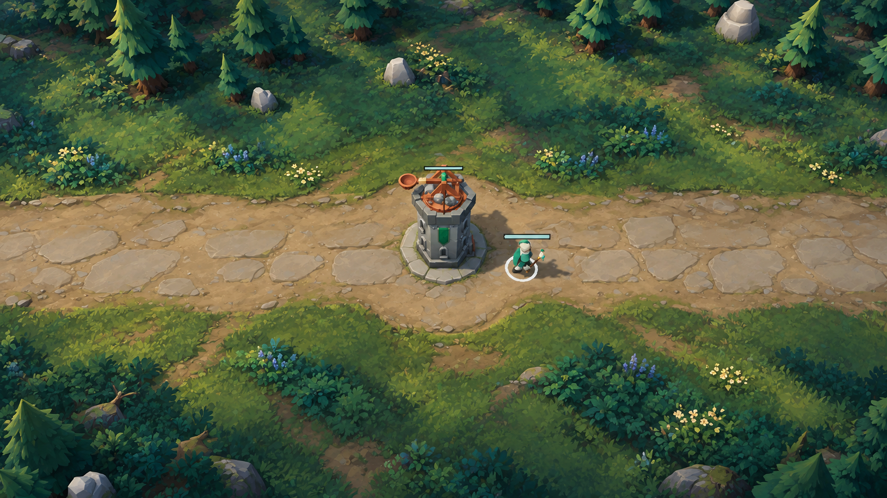
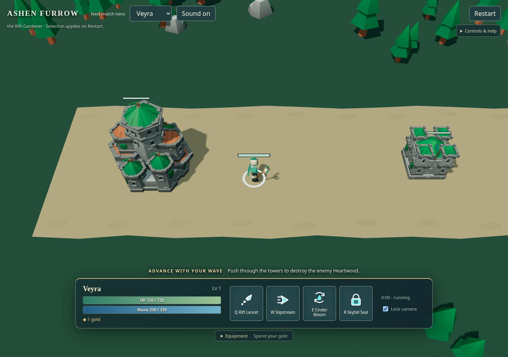
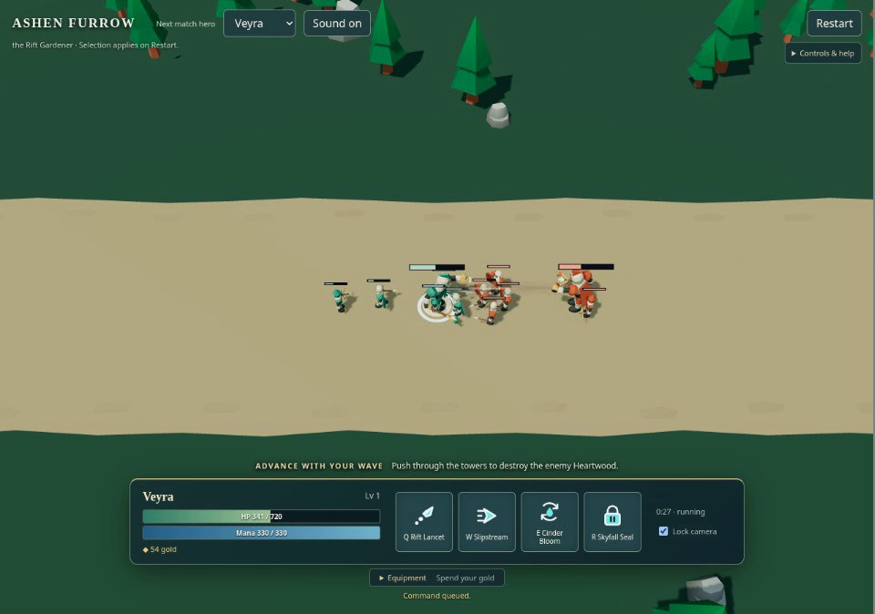
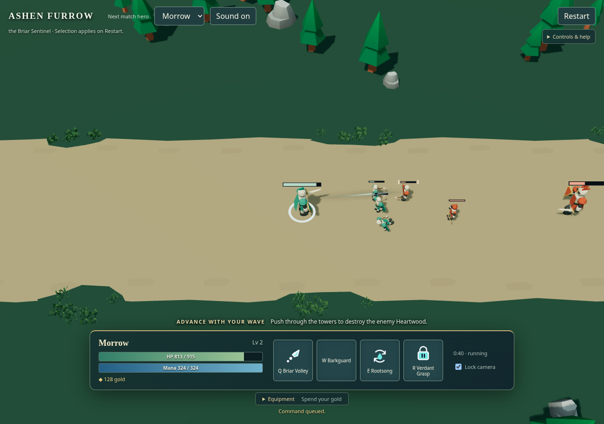
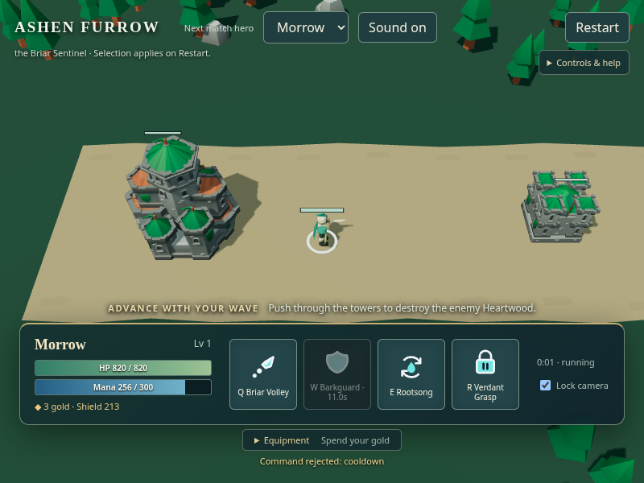
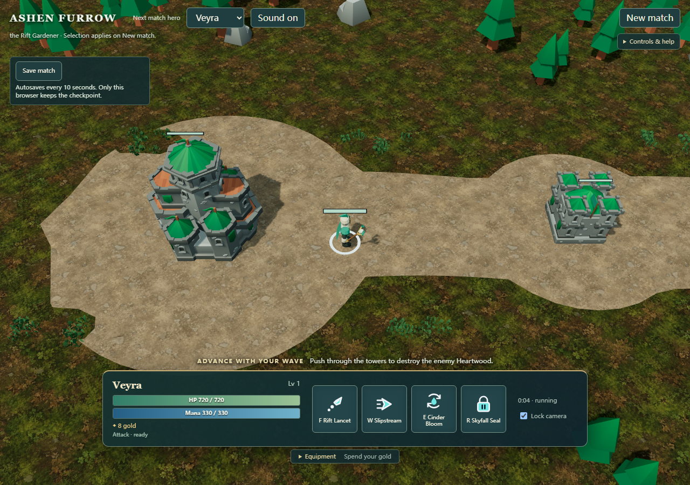

# 当前质量记分卡（2026-10-29）

基线 main `8ade2d1`／运行实现 `9777b840`，Site v14 的 `candidate.html` 为 v11；默认 v10 保留。当前 brief 阶段 A：随一波兵线进入塔前、施放／命中／受击并撤回。离线完整一局是已有功能，不据此把阶段 A 的质量认作完成。

| 线 | 达标线 | 当前 | 最大差距 | 下一单元 |
|---|---|---|---|---|
| 画面 | 四个命名机位各双非作者较低分≥4，且前三层无大差距 | 四机位真实基线已拍；两位非作者文字锚点临时诊断均2/5（非正式分）；first-tower目标可定性沿用，其余目标和锚图未齐 | 当前地表碎噪与简化树木／建筑的细节尺度不统一；另三机位目标和完整锚图仍缺 | 补齐目标及锚图再正式复评；材质层为临时审查首位建议，不替代已指定的灯光候选任务 |
| 手感 | 逐项测量、反馈同帧、非作者对照 | CPU：前摇233.33/300ms、周期866.67/966.67ms；起停/转向命令当tick；屏幕/音画待测 | v12旁置CPU已将ready W拒绝改为Q释放tick5消费；屏幕反馈与动画衔接仍未测 | 对同输入候选补smoke及逐帧非作者判读，详见[前后实测](feel.md#指令缓冲旁置候选v122026-10-29) |
| 内容 | 阶段清单每件与标准件同框非作者确认，100% | **0/89=0%有证据验收覆盖**，不是89件都不存在；类别核对待非作者 | 现有源／文件不等于同档验收，缺动作与声音语义仍在 | 先按下列89件确认类别和标准件，再随最大画面差距选整批 |

## 命名机位与目标状态

四机位名称来自 `src/capture/cameras.ts`，固定1280×720、45°；不能把被拒塔候选额外机位当第五个现行机位。当前仓库的 `current-target.png` 是历史游戏截图，不因文件名被当成目标效果图。

| 机位 | 当前同源截图 | 可用历史素材 | 每机位目标brief | 目标／双盲A、B／较低分 |
|---|---|---|---|---|
| gameplay | 8fcab云端固定基线已拍，见下节 | [9777软件smoke页面](quality/smoke/B-MOBA-COMMAND-ENVELOPE-SMOKE-20261029/2026-10-29T03-31-16Z/page.png)，非命名机位、非固定状态 | 保留兵英雄布局，释放者轮廓/接触点突出，背景压低，不靠HUD堆字 | 待选／待测、待测／待测 |
| spawn | 8fcab云端固定基线已拍，见下节 | 无该机位可核原图 | 保持基地兵营位置，统一石材比例与连续路肩，建立中远景围合 | 待制／待测、待测／待测 |
| first-tower | 8fcab云端固定基线已拍，见下节 | 历史b768分支的baseline GPU帧存在；不是本main原图，也不是被拒tower-standards画面 | 塔冠与塔基辨识、建筑接地和路肩连续，避免光环和过小塔顶 | [目标B已选定](quality/targets/first-tower-paintover-v1.png)，标杆校准4/5；当前实图双盲待测、待测／待测 |
| spawn-to-tower | 8fcab云端固定基线已拍，见下节 | 无该机位可核原图 | 保持出生到外塔路网，以近中远三层贯通基地、内塔、外塔，不加挡路装饰 | 待制／待测、待测／待测 |

[LoL基础玩法参照](https://www.leagueoflegends.com/en-us/how-to-play/)与[Clarity](https://www.leagueoflegends.com/en-us/news/dev/clarity-in-league/)仅是来源入口；first-tower目标已由非作者对照官方正常俯视参考校准，其他三机位同构图参考与完整1–5档锚图包尚缺。商业图不入仓。历史tower美术被否决、二改关闭；本轮不恢复它们。

七层核对：灯光现有半球光/主光/ACES；空间层次仍薄；地面有三材质混合；角色有轮廓区分但拥挤时遮挡；布景有树石草；反馈已有事件与4种声音但未核音画；HUD已有技能与冷却。**这是现有构件清点，不是七层已达标。**

### first-tower 已选定目标（不是实机达标分）

2026-10-29，builtin 图像编辑工具（C2PA标记 ChatGPT / gpt-image）以历史 `b768733` 构建的 **baseline** 首塔GPU原图作paint-over，保留机位、主路、塔和英雄位置与主体关系。生成提示语义摘要：保留构图与玩法布局，以原创风格化MOBA战场方向统一暖石路、草地、林缘和建筑的材质与光照，提升空间层次而不新增玩法；此摘要不是逐字原prompt。目标图不进运行时资产，不恢复被否决tower-standards候选。

独立非作者 `calibrate_moba_target_quality` 实际查看了 Riot [Summer Broadcast Updates: The HUD](https://lolesports.com/en-US/news/summer-broadcast-updates-the-hud) 的官方正常俯视战斗图片（本地参考标识lol-esports-0/1）：候选A为3/5未过，候选B为4/5通过，选B。本仓仅保存B，商业参考和未选草案不入仓。这是**目标图对标校准4/5，不是本作当前截图4/5，也不是当前实图两位互不知情审查者的盲评分**。参考是观战HUD，未据此验本作完整HUD。

目标说明（色值为制作方向近似值，不是采样计量）：

| 主色 | 方向 | 明度角色 |
|---|---|---|
| 深蓝绿 `#123B37` | 林冠/外围阴影 | 最暗外围，托住中央战斗带 |
| 冷绿 `#315D3F` | 林缘灌木 | 中暗，避免叶片噪声抢角色 |
| 草橄榄 `#738047` | 路肩/草地 | 中间层，过渡连续不做发光圈 |
| 暖土 `#9C8053` | 土路与石缝 | 中亮连接面，不暗示新可通行岔路 |
| 暖灰石 `#B2A183` | 主路/塔基 | 主读图区，碎裂变化克制 |
| 敌我青绿 `#168E78` | 友方角色/旗面 | 局部高饱和，优先保主体轮廓 |
| 铜橙 `#AE6137` | 塔顶结构 | 小面积暖色焦点，不压英雄 |

- **明暗**：中央暖亮、上下外围冷暗，眯眼可分主路／过渡／林地三块；单一左上方暖主光投向右下，冷环境填暗部；不靠整体曝光漂白。
- **材质族**：石路/泥土/草三族连续混合，建筑沿同一暖灰石系与铜木构件；接地靠底座和接触阴影，不加光晕。树、草、石密度向外围增加，战斗带保持净空。
- **角色与尺度**：英雄/塔比环境更清楚，不能让微小叶纹比武器主形更精细。沿当前固定镜头保持单位占屏，不通过放大镜头或挪角色掩盖差距。
- **评审仍见三差距**：外围细叶过密；英雄/塔比环境简；可通行与硬阻挡边界不如参照。尤其图下方的小径只是生成图的视觉暗示，**当前导航不可通行，落地必须消除该暗示，不据图扩路或改碰撞**。

原图1672×941、2571715 bytes，SHA-256 `24c66b18401e0e396aa567a353cd9d606b14e02a5e77de233aac0fb4183cfe06`；未重采样／裁切／改像素。PNG块为IHDR、caBX、IDAT、IEND；无EXIF或文本块；caBX含生成来源和公开机构证书签名，已核可读元数据未见私人路径、凭据或私人资料，保留原始C2PA。目标尺寸不等于1280×720游戏取证尺寸。当前四机位原图已在云工作区保存；双非作者已作文字锚点临时诊断，正式评分仍待目标／锚图补齐。

### 历史固定基线拍摄计划（本轮实测见下节）

干净提交构建 `npx tsc -p tsconfig.capture.json && npx vite build --config vite.capture.config.ts` 后，使用现有 `node --import tsx tools/capture.mjs --require-gpu --lease-root "$CAPTURE_LEASE_ROOT" --task-id <本轮独占ID> --seed 1 --t 10 --input march --frames 1 --repeat 2`。不传shot时现有runner拍四机位。既有共享租约根、真实串行许可与原任务清理回执必须先成立，不新建租约根绕过锁。本轮未开浏览器，也未派卡。每机位保留原PNG、source/bundle/renderer/pose/hash和重复比较；历史图不可覆盖。capture只含场内血条、没有HUD/音频，不能靠这四张图证明手感或反馈同帧；其现有idle/march也不能回放上表战斗动作，后续需要最小输入脚本/音画取证接入。

## 本轮云端四机位基线与独立临时诊断（待合文档差量）

本节记录已发生的拍摄和审图，不新建状态单元，也不代表新增画面改善。固定源码 `8fcab371108f23b8be659eef1db0466561e3b597`，tree `e72877d4db44e49eea3f177d3a4977055022234d`；实际 capture 内容为 v11，不是 v12 手感画面。1280×720、DPR 1、FOV 45°、seed 1、input march、t=10、virtualFrame 600、simTick 300、simTime 10、fixedDt 1/60、warmupFrames 12；四机位各重复两次，PNG／RGBA／状态／机位重复检查通过。仅场内血条，无控制HUD或音频，不据此验手感、反馈同帧或声音。

Chromium 154.0.8037.57；原始 renderer：`ANGLE (Google, Vulkan 1.3.0 (SwiftShader Device (Subzero) (0x0000C0DE)), SwiftShader driver)`，分类 software。实际上下文 antialias=true，MAX_SAMPLES=4、SAMPLES=4、最大各向异性16、支持的压缩纹理格式列表为空，实际纹理格式未观测。配置为 ACESFilmic、exposure 1.12、shadowMapSize 1024、关闭自适应质量。**配置 PCFSoftShadowMap，但 Three 运行时明确回退至 PCFShadowMap；后者才是实际生效阴影算法。** 浏览器真实退出码0、signal=null；runner退出0；本轮预览端口已关闭且拒绝连接。

本云工作区保留 `outputs/quality-baseline/run-8fcab371108f-march-r2jpOX/`，每机位两个 `*-r1/00000.png`、`*-r2/00000.png` 及元数据，根目录 `report.json`。这些PNG尚未上传或纳入仓库，本待合文档不声称远端已有图片。

| 机位 | camera position | target | PNG SHA-256（r1=r2） |
|---|---|---|---|
| gameplay | (-24.23333333333305, 24, 19.200000047683716) | (-24.23333333333305, 0, 1.2000000476837158) | `b493e53a67c7e24d0c3cd08af23b28a0446e1c3b165f869ec21b0f4bd8259e06` |
| spawn | (-94, 24, 19.2) | (-94, 0, 1.2) | `c32cf0757b710f5c33ac77c651df98de2a03a4a774ce46b844c23ba3c3eaa08a` |
| first-tower | (-28, 24, 18) | (-28, 0, 0) | `a8e55ad4de4018276ffb56c6cfcf10b97deefa954922b1fe1b0d6b9502c436ad` |
| spawn-to-tower | (-65, 62, 46.5) | (-65, 0, 0) | `ada06f0232c3e9b28548c670c613fa8726ed1ce95e594761159ee530eeb61551` |

两位互不知情的非作者审查者 `visual_review_a`、`visual_review_b` 各自直接查看四张本轮PNG及既有first-tower目标，未读取作者实现或彼此结论。以下仅按quality-bar文字锚点作临时诊断；缺完整1–5档锚图，另三机位也缺目标，**不能升级为正式盲评、目标达成分或正式验收**。

| 机位 | A临时分 | B临时分 | 较低临时分 | 可见前三差距（双方共同意见） |
|---|---:|---:|---:|---|
| gameplay | 2/5 | 2/5 | 2/5 | 草地高频重复纹理；草土硬边；物件孤立、缺少疏密分组 |
| spawn | 2/5 | 2/5 | 2/5 | 土色广场空；建筑／树／地表细节语言分离；接地和路肩生硬 |
| first-tower | 2/5 | 2/5 | 2/5 | 相对有效目标缺大块石路与安静草色；林缘层次稀薄；塔基与道路交接生硬 |
| spawn-to-tower | 2/5 | 2/5 | 2/5 | 重复地表占比过大；道路沿线空间节奏弱；树石散点缺乏区域组织 |

两位均确认first-tower现有目标的塔／角色位置、道路高度、扩宽区域和裁切关系基本对应，可沿用作定性视觉比较。目标1672×941与本图1280×720不同，不能逐像素比较；新增绘制细节也不是几何等同证明。目标下方暗示的小径仍不得变为新通路。

共同第一差距是地表与简化物件之间的风格和细节尺度不统一。两位独立建议优先测试材质层：降低细碎噪声、建立大色块和石土结构、改善草土／塔基过渡；树木体积、空间围合留后续独立比较。本建议不取代已指定的灯光旁置候选顺序，本次未改任何灯光、材质、玩法或默认入口。

原生图像编辑工具已基于本轮gameplay实图生成一张手绘目标小样。独立非作者实际看图后确认构图和主路布局基本保留、手绘语言改善，但角色武器、树冠体积、塔与局部道路轮廓被重绘，未满足严格几何保持要求。小样仅留云工作区，未上传、未选定为目标、未扩展其余机位，不能将其计作目标齐备或画面改善。

第二次有界修改再次以原始gameplay PNG为唯一几何依据，明确只收敛照明、地表噪声和色调。独立复核实际看图：低多边形树冠语言恢复、改动范围较首版收敛，但武器握姿／肩臂、塔身开口与底部台阶、局部树干和路沿仍重绘，严格几何约束未通过。两版原图与完整提示均保留云端；第二版只能标为“调色与地表材质参考，局部轮廓存在偏差”，不选定、不评分、不扩展其余机位，本轮停止生成。

待补：gameplay、spawn、spawn-to-tower的同构图原创目标及独立校准，完整1–5档锚图包，然后按两位较低分逐机位正式复评。现有first-tower目标历史4/5是目标校准，不是当前画面分。阶段A内容验收覆盖0/89不因临时审图改变。

## 灯光层旁置 forest-light-v1（视觉验收待本轮同机位实测）

显式 `?lighting=forest-light-v1`；默认 baseline 和旧 stylized-diffuse 都保留。依据首塔当前图与既有目标：当前暗部偏黄褐、塔与路肩接触关系弱，目标是冷绿外围与暖路面的明暗分工。本层不补目标里的石板、植物体量或塔基几何。

实际材质路径已核：baseline 的 glTF／地表为 Standard/PBR，旧 stylized-diffuse 才转换 Toon；新候选保持原材质身份，用天空／地面双色 HemisphereLight 加弱 AmbientLight 提供真正独立的间接光，暖主光建立直接明暗。没有设置 scene.environment 或宣称使用 HDRI。AO 使用固定采样的 Three SSAOPass，半浮点离屏世界画面经线性冷暗／暖亮调色后由 OutputPass 统一 ACES 与色彩转换。世界原材质额外深度绘制后再合成 cue，保持原 alpha/skinning、深度与 toneMapped 语义，不把世界AO乘到血条和技能提示。固定采样不随帧率调整，所有新增资源随世界释放。

实施依据为安装的 Three 0.186.1 源码：lights_fragment_begin、lights_physical_pars_fragment、SSAOPass、EffectComposer 和 OutputPass；[官方文档入口](https://threejs.org/docs/)用于核对路径。候选显式使用 PCFShadowMap；baseline仍保原配置 PCFSoftShadowMap及其运行时PCF回退，不能把配置名当生效算法。额外 normal/AO/blur/grade/output、世界深度及cue绘制增加成本，不承诺性能改善。

独立代码审查发现并已修复 cue 后处理污染、Sprite排除、AO投影更新及上游dispose遗漏。CPU与构建、真实图像重复、两位非作者首塔对照及另外三机位回归均以本轮实际结果补充；此段不预填通过。

## 阶段A内容清单与验收分母

计数规则：一件是一个可独立与同类标准件同框验收的**角色/动作/视觉语义/音频语义/UI面板**，不是文件、实例或功能测试数。同族敌我变体一并验收、不重复计数；复用一个clip不能自动让多个技能动作通过。下表列出全部89件；存在数只写源码/资源能证实的量，不计为验收分子。每件目前同框非作者证据均缺，因此分子0；不是画面评分0。类别完整性仍需另一审查者核对。

| 类别 | 当前阶段要求（逐件展开规则） | 清单件数 | 实际现有量／缺口 | 标准件同框通过 |
|---|---|---:|---|---:|
| 英雄外观 | Veyra、Morrow（双方变体） | 2 | 2族4个模型；Morrow剑盾与远程攻击身份不一致 | 0 |
| 英雄动作 | 每英雄idle/walk/attack/hurt/death/Q/W/E/R，共2×9 | 18 | 每族5基础clip，共10；4技能槽复用动作而非8段独立验收 | 0 |
| 敌兵外观 | melee/ranged/siege，双方变体 | 3 | 3族6模型 | 0 |
| 敌兵动作 | 每族idle/walk/attack/hurt/death，共3×5 | 15 | 15基础动作；siege另有prepare/release/recover与preview，不重复膨胀分母 | 0 |
| 中立单位 | brief阶段A不含野区 | 0 | 0；明确不适用，不漏列 | 0 |
| 场景各层 | 石路/泥土/草地、路肩、围合远景、树、岩、塔、兵营、基地 | 10 | 3地表材质；草簇/树/石、3建筑族已有；围合远景缺；两阵营共6建筑模型不重复计件 | 0 |
| 道具/武器/装备 | sunsteel_blade/warden_plate/wayfarer_boots | 3 | 3数据项；角色武器随英雄整件验，不当新增独立外观 | 0 |
| 技能/命中特效 | 8技能完整效果；普攻准备/释放/接触；伤害/护盾/控制/死亡/金币反馈 | 16 | 8技能规则；共享弹道/区域/预警/受击表现，完整16语义尚未逐一实图验明，金币专用反馈缺 | 0 |
| 音效 | 普攻/施放/HP命中/盾吸收/塔出手/死亡/补刀/移动/控制/胜利/失败 | 11 | 4录音和路由；其余7无专用语义样本/路由，不能用复用音色填完成 | 0 |
| 音乐 | 一套本段战斗/环境音乐 | 1 | 0，未接入 | 0 |
| 界面 | 生命资源/技能栏/目标威胁/成长金币/商店/结算/帮助/键位设置/保存续玩/英雄选择 | 10 | 10类已有实现；目标威胁包含场内边界，不等于全部HUD品质已验 | 0 |
| **合计** | **2+18+3+15+10+3+16+11+1+10** | **89** | 源存在与品质验收分开 | **0** |

证据入口：`src/content/catalog.ts`、`asset-pipeline/battle/exported/`、`asset-pipeline/heroes/veyra-release/exported/`、`asset-pipeline/content-set/siege/exported/`、`src/render/`、`assets/audio/battle/README.md`、`src/audio/battle.ts`。动画数量直接读glTF animation数组；不把历史素材来源审查当品质验收。已有source-lineup等图尚未对上述每件建立标准件同框非作者结论。

**本轮没有新的已证实画面改善。后续补齐四机位同源目标与正式双盲闭环，优先解决“无法可靠比较”的最大证据缺口；手感已定位缓冲缺口但不在此同时改玩法。**

---

# 一次基本战斗：出手身份、路肩与完整技能栏

## 参照与历史画面（2026-10-26）

主参照为 [英雄联盟官方 How to Play 的实际战斗片段](https://www.leagueoflegends.com/en-us/how-to-play/)与 [Clarity in League](https://www.leagueoflegends.com/en-us/news/dev/clarity-in-league/)：在正常俯视尺度，通过武器轮廓、身体主姿势和效果层级辨认谁在出手。参照素材只用于比较，不进入游戏；并排图只保留本地。

2026-10-26，作者候选 `61298c4`，默认模拟仍为 10。第一张为 1280×900 实际页面；第二张为同段连续录像的原生 960×675 帧，约 28.7 秒，不是精确逻辑 tick 对齐或同帧 A/B。正常输入完成跟随兵线、右键敌兵、真实 `basicAttack`（tick 817）和点地移动（tick 920）；测试归档仅增加有界的逐逻辑步只读事件观察。

## 历史采用（2026-10-26）

- Veyra 的 5.2 米即时普攻改用植物 focus 与伸手释放；不再以短剑挥向远处空地。Morrow 与小兵动作、模拟规则未改。
- 复用原十五骨骼与 idle/walk/hurt/death 源；武器使用植物 focus，attack 则采用 [Quaternius UAL1 免费 Standard 的 CC0 施法三段](https://quaternius.itch.io/universal-animation-library)。按两套骨骼的实际空间侧映射上半身，而不是照搬左右后缀；源根与腿不进入角色移动。真实 cast 的准备与提交仍由实际事件控制；即时普攻没有凭视觉创造伤害前准备。
- 已提交的短释放期间，普通 HP 受击使用相对参考姿势的轻量躯干叠加，不整段替换手臂；真实控制和死亡仍优先。绘制跨过当前动作主姿势时，只在原视觉生命周期内补呈现一次，不排队、不改伤害时点。

本轮采用 Veyra 远程出手身份与主姿势的有限改善。正常序列中，肩高伸臂已从躯干外显出，前倾与收回比自制低位出手更明确；准备结束的伸臂是 ready 姿势，不代表已命中。主姿势和武器身份有所改善，不等于攻击、命中与声音整段已达到参照。

## 历史同轮接入的已评改善

这两张来自各自先前固定候选的实际正常画面，不是与上方英雄帧同一时刻，也不把它们称为组合树的并排对照。路肩只用少量 CC0 草簇接住道路边缘，中央战斗带仍留白；保留整批屏外实例也会提交的成本边界。Morrow W 按真实 self-shield 语义接入 MIT 盾图标，不用图案替代文字与冷却。

组合同时保留已核的导航返回数组释放、玩家视角单次结算公告、窄窗口完整技能行。正常新局与重开仍使用模拟 v10；旧版本回放兼容。组合严格浏览器检查覆盖两英雄、技能、冷却布局和重开，但不是整局胜负或手感评估。

## 历史最大差距（2026-10-26）

1. **兵群仍遮住释放主形**：伸臂不再完全藏在躯干内，但手部与小兵、血条仍会重叠；远程发起方尚不能在所有拥挤时刻立即辨认。
2. **命中关联与力度仍弱**：现有短束连接、目标侧确认和身体动作尚未形成明确的整体节奏。
3. **角色与场景品质仍有距离**：新武器没有解决简单躯干造型、平涂宽路和稀疏环境层次；声音的主观质量仍待实际听验。

当前基本战斗未达到英雄联盟参照品质。本页随下一轮真实片段替换。

## 历史网站 v13 的 v11 旁置：机制已接入，品质仍未达标（2026-10-28）

[在线旁置](https://dbvv1-moba-like.pretty-llama-9945.chatgpt.site/candidate.html)已接入普攻准备／发射／接触循环、独立攻城模型、连续地形、改键与本机续玩；默认首页仍为 v10，不替换原体验。准备可取消、发射后可走位／接技能，远程弹体接触才产生命中；规则边界见 [brief 的 v11 合同](brief.md#v11-候选一次可取消可走-a-的普攻)。

本图来自源码 `935bf8e` 的实际软件 WebGL smoke，保留原图；上方 `veyra-release.png` 为 2026-10-26 历史前图，地点、时刻和尺寸不同，不是同条件 A/B。相较历史平涂场地，本图可见道路与地表纹理分层，以及保存和改键后的界面状态；它没有展示兵群里的发起／命中关系，不能据此判断完整战斗节奏已改善。独立自制目标图仍缺，不以商业参照图或新生成图补充本轮证据。

当前最大差距仍是拥挤战斗的出手身份与命中关联，以及简单角色造型与场景细节的协调；连续纹理没有解决这些问题。真实键鼠完整战斗序列、非作者与官方片段并排复评、手感、声音和平衡仍未评，本轮没有品质或真 GPU 通过结论。

[本轮功能报告](quality/smoke/B-MOBA-BACKLOG-SMOKE-20261028/2026-10-28T16-59-50-659Z-192910/report.json)的固定源码串行断言通过，实际 renderer 为 SwiftShader，仅证明软件 WebGL 功能；[12:09 轮](quality/smoke/B-MOBA-BACKLOG-SMOKE-20261028/2026-10-28T12-09-36-086Z-68556/report.json)和 [14:59 轮](quality/smoke/B-MOBA-BACKLOG-SMOKE-20261028/2026-10-28T14-59-25-771Z-171715/report.json)失败记录仍完整保留。
