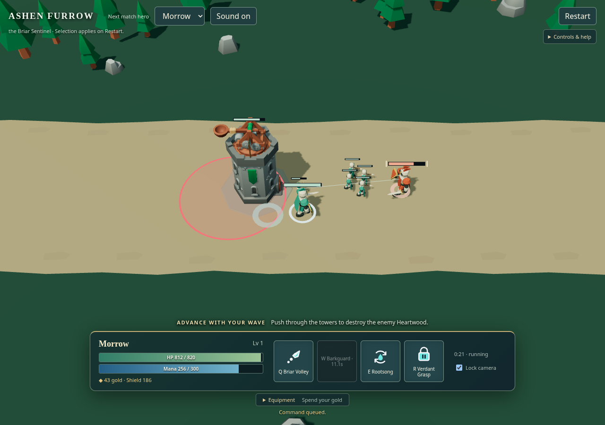
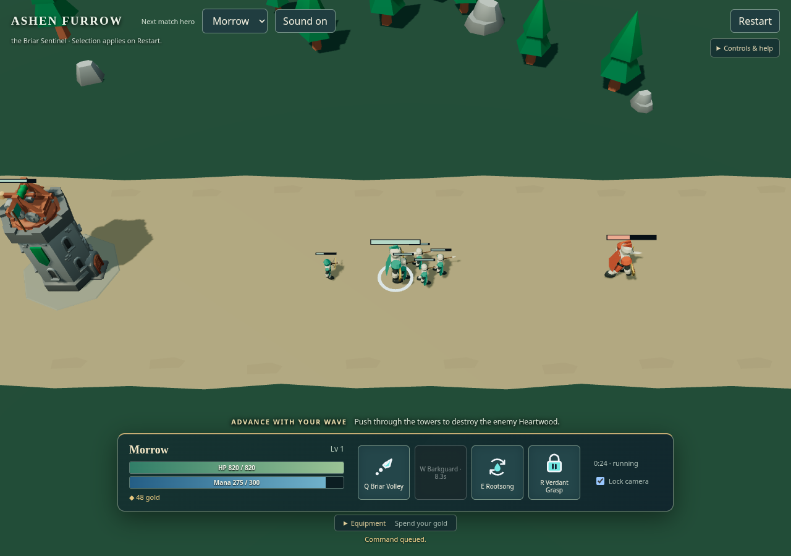

# 一次基本战斗：标明当前攻击目标

## 参照与本轮画面

主参照为[英雄联盟官方基础玩法展示](https://www.leagueoflegends.com/en-us/how-to-play/)的 **Earn Gold／Abilities** 片段：在移动、出手和范围技能并存时，玩家应能辨认自己的目标与危险来源。地景轮廓另参照 [Thronefall 官方画面](https://store.steampowered.com/app/2239150/Thronefall/)。参照并排图只保留本地。

2026-10-26，固定源 `1c176a9` 的正常 Morrow 跟随兵线、A＋左键、S、再次 A 操作。原尺寸截图分别取于逻辑 tick 645 与 727；采用源 `7890eb2` 保留相同的目标括号。两张图是同一连续操作的不同状态，不是同帧 A/B。

## 已采用的改变

- 在当前攻击／追击目标的原血条两侧标出浅色括号，不挪动血条，也不再增加连接线。
- 直接读取当前玩家的目标 ID；停止、改为移动、目标死亡或结束对局时撤去。对象隐藏时不单独留下提示。
- 括号只回答“我的当前目标是谁”，不代表已经进入射程、攻击命中或目标被硬锁定。既有淡色出手短束与真实命中反馈保留各自语义。

非作者按原尺寸复看目标取得、持续追击、停止与重新取得后，接受当前敌方英雄比无标记时更容易识别这一有限改善。此次画面有己方兵群，但没有证明贴身多个敌方挤在一起时仍能立即选出目标。

## 最大差距与下一步

1. **敌方发起与真实命中仍弱**：当前目标变清楚，不等于敌人正在攻击谁变清楚。下一步沿真实出手／命中与动作关联改善，不用目标标记冒充命中确认。
2. **密集小兵目标与死亡仍难辨认**：细括号在远距小兵上的实际阅读尚未覆盖；既有倒下动作也常被活单位遮住。应在正常接战中处理轮廓与遮挡，不回到阶梯血条或大光柱。
3. **场景与声画层次不足**：宽直平涂道路缺少参照的空间层次；声音仍缺实际主观听验。

当前基本战斗未达到英雄联盟参照品质。本页随下一轮真实片段替换，不累积逐次过程记录。
