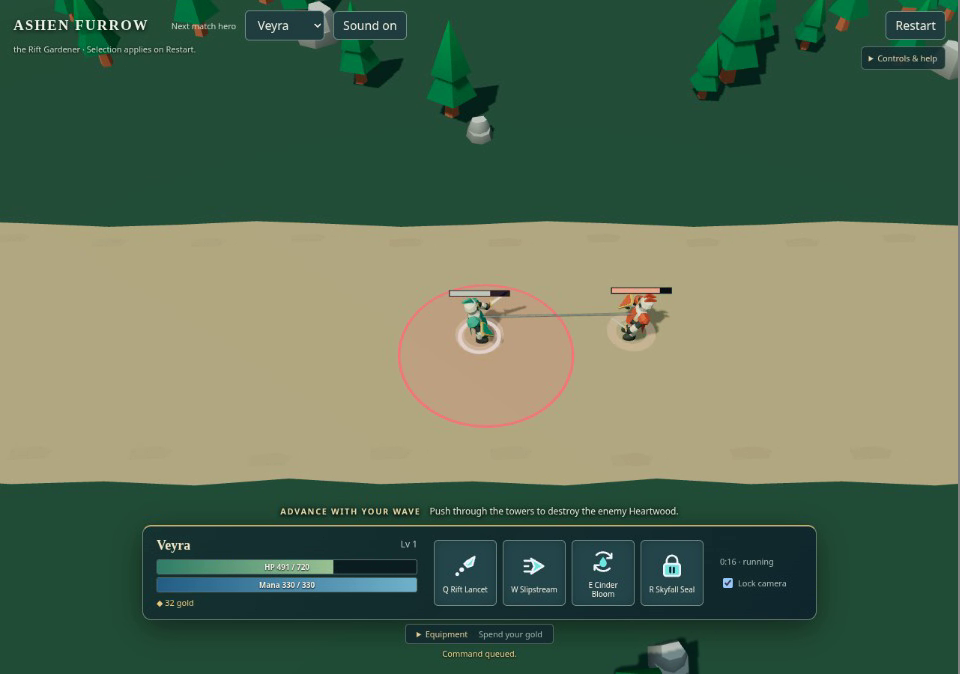
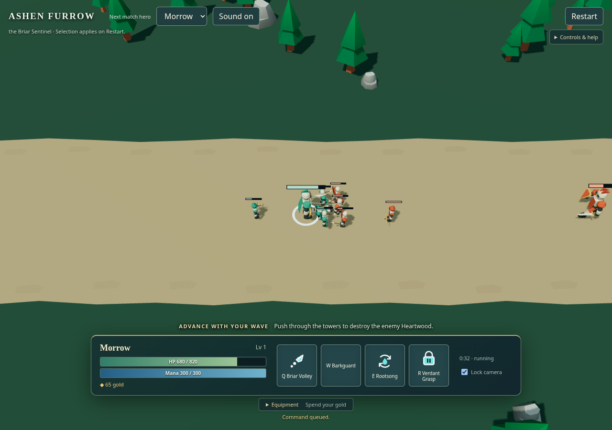

# 一次基本战斗：出手与死亡的连续性

## 参照与本轮画面

主参照为[英雄联盟官方基础玩法展示](https://www.leagueoflegends.com/en-us/how-to-play/)的 **Earn Gold／Abilities** 片段：比较出手者与目标的关联、真实命中、单位死亡和危险信息的主次。地景轮廓另参照 [Thronefall 官方画面](https://store.steampowered.com/app/2239150/Thronefall/)。参照并排图只保留本地，不复制其资产。

固定源 `8386a91`（正式 `69d1588` 的相同运行代码），2026-10-26 正常 A＋左键连续录像的 17.45 秒原尺寸帧。图中的短连接表示已承诺的普攻，不是飞行弹道或命中证明。红区仍是敌方技能范围。

固定源 `c80e925`（正式 `c45c2eb`），正常交战中的死亡尾段。死亡兵立即退出模拟、拾取和血条，既有倒下动作短暂保留后释放；拥挤处仍很难一眼辨认。

## 已采用的改变

- 普攻短反馈至少保留首次绘制机会，避免长帧在首绘前把短效果删掉；致死清理后的出手端点只从同批权威死亡事件补全。
- 英雄普攻从一像素线变成窄几何连接，跨红色技能区仍能看见源与目标的联系。
- 小兵不再当帧消失，而是播放已有死亡动作；没有把倒下表现重新放回战斗或选择集合。

非作者按原尺寸与连续帧复看后，接受源目标联系可见、死亡不再硬切这两项有限改善。两段使用正常输入而非改写模拟状态；不把不同战斗时刻称为同帧 A/B。

## 最大差距与下一步

1. **谁在打谁仍不够直观**：连接像细暗绳，方向和目标侧命中确认弱。下一步优先改善源端与目标端的不同形状及主次，不用假飞行延迟修改瞬时结算。
2. **死亡被活单位遮住**：倒下动作虽连续，群中仍像少了一个轮廓；先解决动作轮廓与遮挡，不用大光柱代替死亡动作。
3. **场景与声画层次不足**：宽直平涂道路缺少参照的空间层次；声音尚无实际主观听验，接线成功不能代填听感。

当前基本战斗仍未达到英雄联盟参照品质。本页随下一轮真实片段替换，不累积逐次过程记录。
