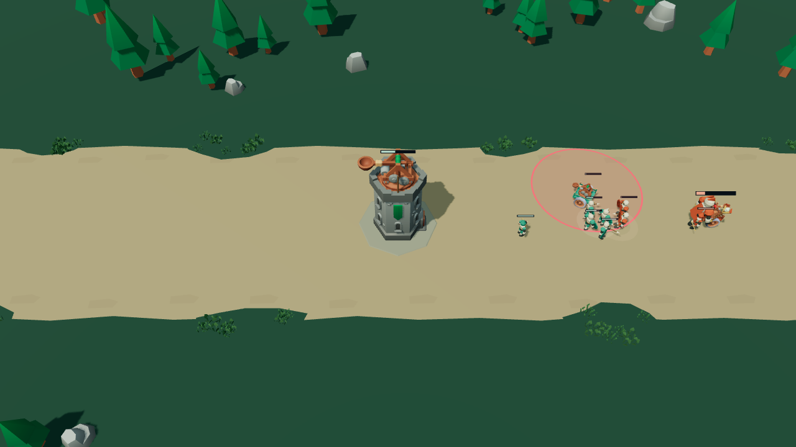
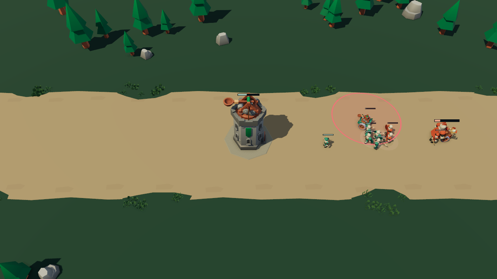
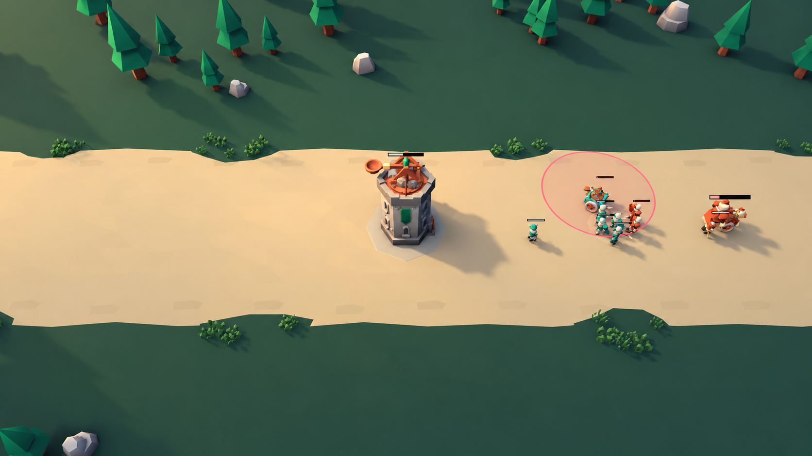

# 塔前灯光：让单位接地，让环境退后

**当前为候选版本 `0b8f93c`，尚未进入 `main` 或公开 Site。** 非作者同机位盲评认为它小幅优于基线：塔、小兵与车辆的接地和体积更清楚，青橙阵营及粉色范围圈仍可辨；保留这次阶段性改善，整体画面尚未达到目标。

## 同机位真实画面

两张均为 dot 云端 **llvmpipe 软件 WebGL** 的原始 canvas PNG：`first-tower`，seed 61，idle，frame 16，逻辑时刻 101.2666667 秒，1280×720。对局状态、相机和视口相同。

**改前 · `64190c6`**

**候选 · `0b8f93c`**

## 这次改变

- 用 CC0 HDRI 经 PMREM 提供天空填光；加载时分离日盘，由单一方向光负责可遮挡的日照，避免太阳能量同时变成无阴影填光。原 HDR 文件保留，配方与许可见[灯光素材说明](../assets/lighting/README.md)。
- 保同一相机、模型、底色和玩法，接入局部接触 AO、固定 ACES 输出与同色系天空／远雾；不靠继续抬亮或加重 AO。
- HUD 与技能提示不参与 AO；保留原有深度测试／写入、色调映射和透明混合，需要深度测试的提示仍按实际世界深度遮挡。

这张实帧的提交量从 **296 → 455 draw calls、90,968 → 155,269 三角形**；额外成本主要来自 AO 法线／深度 pass。软件帧时间尚未测量。

## 最大差距

1. **阴影偏黑硬**：树影边缘生硬，塔暗面的细节开始合并；下一次应恢复暗部层次，不再整体压黑。
2. **地表和光色仍单薄**：道路土黄、草地偏灰橄榄，大面积平涂缺少材质与空间层次。
3. **动态读图仍有缺口**：英雄走到友方建筑后会被遮住；单位尺度和拥挤轮廓、连续出手到命中的读图、声音与手感还需完整复评。

普通入口已实际加载并推进，右键移动与 Q 瞄准线可见；短暂 Q 弹体未完整观察。完整自动 smoke 仍受执行入口限制，GPU 与完整手感未知。

## 灯光方向图

**AI 生成目标，非游戏实机。** 图中仍有几何和尺寸漂移，只参考光色、明暗分组和接触方向，不用于像素对照或验收。

[图片来源](quality/lighting-images.md)。品质参照：[英雄联盟官方基础战斗](https://www.leagueoflegends.com/en-us/how-to-play/)、[Clarity in League](https://www.leagueoflegends.com/en-us/news/dev/clarity-in-league/)。商业参照图不随本页分发。更新：2026-10-27。
